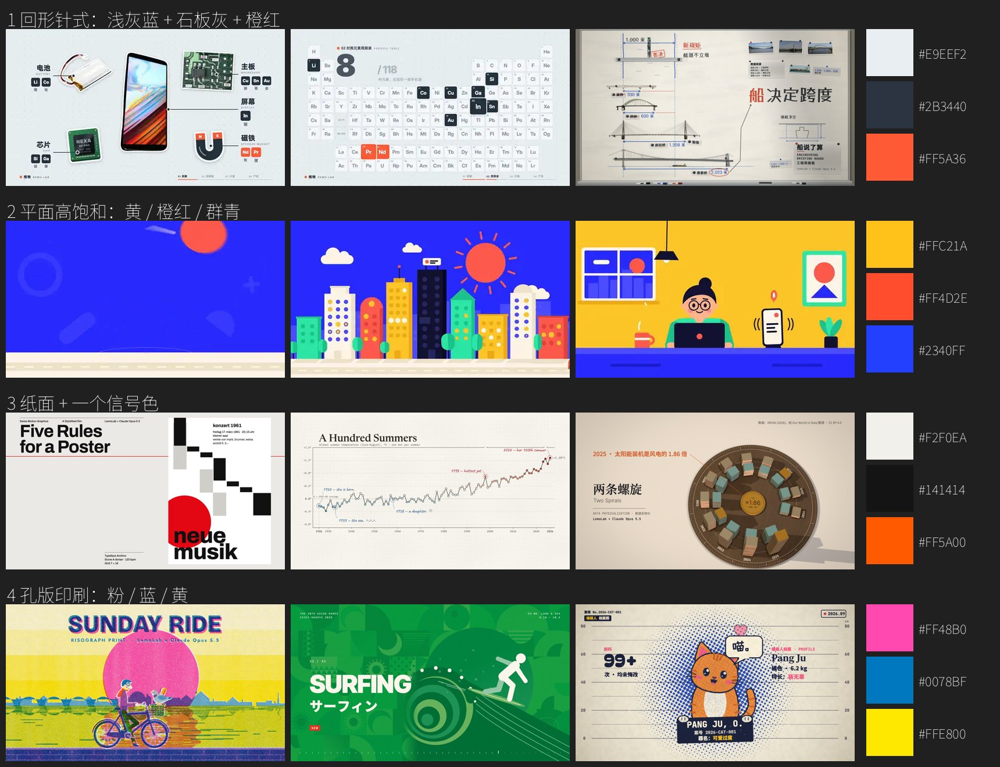

# 账号风格：每支片都一样的东西（账号层）

> 用户 2026-10-23：“视频风格需要和我的账号主题一致。”
> 结构学自 pdoom-video：每个图版的视觉语言都不同，但**配色、字体、颗粒、语气统一**，所以是一部片（[学习/pdoom-video.md](学习/pdoom-video.md)）。这里定“账号层”（每支片都一样）；“单片风格层”（世界、媒介、镜头、母题）每支片按题材选（[导演方法.md](导演方法.md) §二）。
> **状态：提案，待用户确认**（2026-10-23）。确认或修改后把这一行改掉，并记进 [经验.md](经验.md)。

## 账号是谁

- 名字和人设：**学术小白**（策划稿的署名，“马飞龙”）；题材：AI 工具和 AI 新闻（[quick-reference.md](quick-reference.md) §〇）。
- 人设的意思（提案）：一个认真读论文、读新闻、自己动手试的“学生”，把看懂的东西讲给同样好奇的人听。**准确、克制、好奇，有一点冷幽默**；不吹、不制造焦虑、不当“大师”。
- 由此来的画面气质：**像一份做得很好的学习笔记 / 研究简报**——有出处、有标注、有图表，干净；不是发布会，不是综艺。

## 账号层（每支片都一样）

| 项 | 提案 | 理由 / 来源 |
|---|---|---|
| 配色 | **账号层固定的是“取色方法”，不是一套颜色**（huashu-motion colour.md：颜色是找来的；21 支发布片里 19 支的颜色来自产品 / 素材本身）。不再用“藏青黑底 + 金色”（用户 2026-10-23：“配色很屎”“看着沉闷”）。每支片：从素材里取色（论文的图、产品界面、官网 CSS），按角色排（底 / 面 / 中性黑白字 / 一个强调色 / 可选满屏色），写在 `## 导演`「风格」里并注明“来自：…”；明亮、有对比、去色后层级还在；避开 AI 通用样子（深底 + 暖色强调 + 米白字；米白 + 宋体 + 橙；近黑 + 荧光绿；紫蓝渐变）。账号层只固定：字是中性黑 / 白，荧光笔黄 `#FFD43B` 是“批注”专用 | huashu colour.md §1–§4；第一次校准（agent-compute-hijack 用论文图 1 的蓝 / 橙两个世界）见 [assets/校准-agent-compute-hijack-前后.jpg](assets/校准-agent-compute-hijack-前后.jpg) |
| 字体 | 标题、字幕：**思源黑体**（Noto Sans CJK）Heavy / Bold；数字：Inter Display 或思源黑体 Heavy；代码和读数：等宽（JetBrains Mono / Noto Sans Mono，OFL）；**批注**：霞鹜文楷（手写感，像笔记里的批注，`hand`）；**思源宋体** Black 只在题材需要时用（历史、人文、书信、名画，`serif`）。宋体和文楷已随仓库提供（`public/fonts/`，`src/tutorial/fonts.ts`） | 全部可免费商用（[平台与合规.md](平台与合规.md) §三.8）；“批注”是学术小白人设的签名 |
| 字幕 | 白字粗描边，60–66 px，中线约 y 1390；关键词变成信号色；不挡主体 | 抖音知识区习惯（静音也能看） |
| 账号签名动作（提案） | **荧光笔划重点 + 页边批注**：关键句被强调色荧光笔扫过（现有 `Marker`）；需要补充说明时，旁边用霞鹜文楷写一行小批注、一根引线指过去 | 学生读书的动作；每支片都能用，又不限制世界和风格 |
| 页眉 | 左上一行小字：栏目名（`series`）；右上一行：出处 / 声明（`credit`） | 现有做法，保留 |
| 第 0 帧 | 有主角、有一个大字结论或数字、已经在动 | huashu-motion、抖音黄金 3 秒 |
| 结尾 | 停在一句金句或回到钩子的画面，停 ≥ 1.5 秒；不做 logo 片尾卡、不引导关注 | [平台与合规.md](平台与合规.md) |
| 封面 | 统一版式：左上两行标题（第二行信号色）、一个主体锚点、一行辅助句、角标栏目名；9:16 / 3:4 / 6:7 各排一次 | [封面.md](封面.md)；现有 `coverCard` |
| 质感 | 轻颗粒（ffmpeg 里加）；发光只给强调色，而且只在深底片里用 | pdoom-video 的统一质感 |
| 声音 | 用户本人的复刻音色；克制的电子底乐；纸、笔、键盘、点击这类“学习桌面”的拟音 | 人设 |

## 配色候选（2026-10-23 的提案，已被 huashu 的取色方法取代，留作记录）

来自库里成片的配色逻辑（看 [学习/mg15-成片抽帧.jpg](学习/mg15-成片抽帧.jpg)、[学习/lemo-知识类风格.jpg](学习/lemo-知识类风格.jpg)），每套都在浅底和深底各试一张风格帧再定：

1. **回形针式**：浅灰蓝 / 米白底 `#E9EEF2`，石板灰字 `#2B3440`，强调橙红 `#FF5A36`（`mg15/19-paperclip`）。冷静、像研究简报。
2. **平面高饱和**：明黄 `#FFC21A` / 橙红 `#FF4D2E` / 群青 `#2340FF` 三色块轮换做底，白字黑字（`mg15/01-flat-vector`）。热闹、抓眼，适合轻松题材。
3. **纸面 + 一个信号色**：米白纸 `#F2F0EA`，墨色 `#141414`，信号橙 `#FF5A00`（lemo `swiss-motion` 的做法）。干净、高级、有设计感。
4. **孔版印刷**：粉 `#FF48B0` + 蓝 `#0078BF` + 黄 `#FFE800` 叠印，纸纹（lemo `risograph`）。有温度，适合人文 / 轻松向。

**更正（同日）**：读了 huashu-motion 的 colour.md 以后，第 3 套（米白纸 + 橙）正是它点名的 AI 通用样子之一，四套都是“编出来的”而不是“找来的”。所以不再让用户在这里挑一套固定配色；账号层只固定“取色方法 + 中性字 + 批注黄”，每支片从素材里取色。

## 单片风格层（每支片自己选）

- **世界**：深底（夜里的书桌 / 屏幕）、浅底（纸、白板、简报）、照片 / 录屏为主。明暗可以在片中交替（pdoom 的“米白纸 + 墨线”图版）。
- **风格**：从 lemo / mg15 按题材选一种（知识类候选见 [学习/lemo-opuscar.md](学习/lemo-opuscar.md)）。
- **媒介**：Remotion 或网页（Canvas / WebGL / three.js / p5），见 [导演方法.md](导演方法.md) §三.4。
- **母题、镜头语法、原生招式**：每支片不同。

## 待用户确认

1. 账号名字、头像、有没有现成的 logo / 主色；人设是不是“认真读论文的学生”。
2. 配色：同意“每支片从素材里取色、账号只固定方法”吗？有没有已经定好的账号主色 / logo 色（有的话它就是“品牌自己的值”，排在取色顺序第一位）？
3. “荧光笔 + 批注”当账号签名，可以吗？
4. 有没有特别喜欢、想靠近的中文账号（比如回形针、林超、星球研究所，或某个 AI 区的号）？
